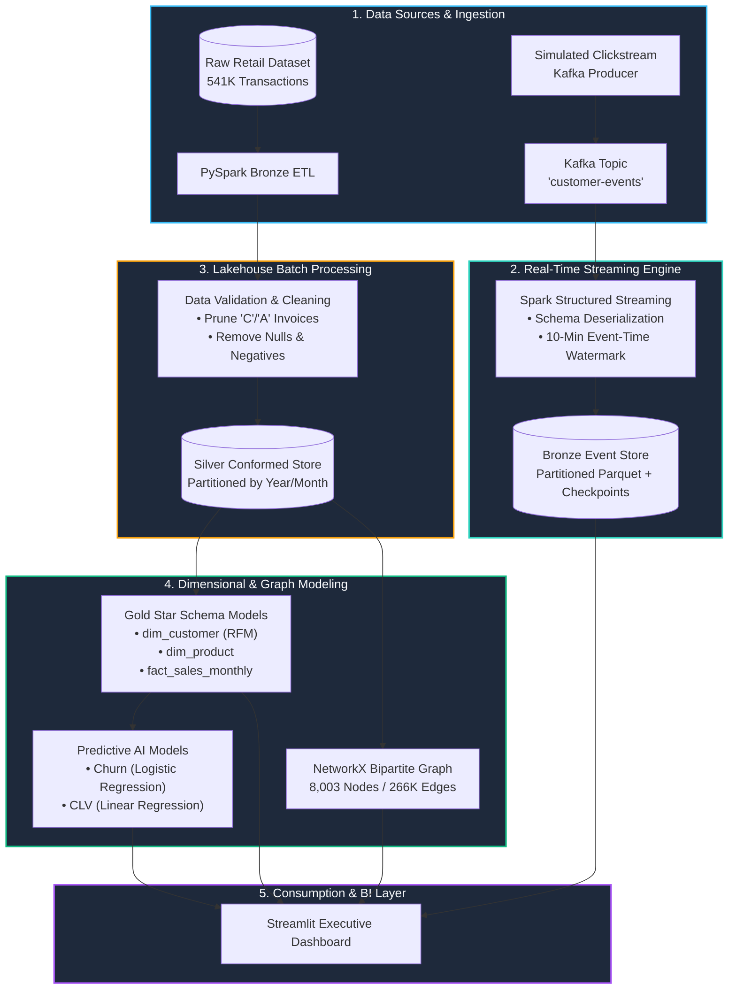
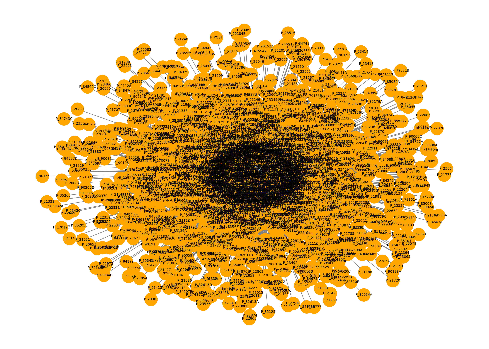
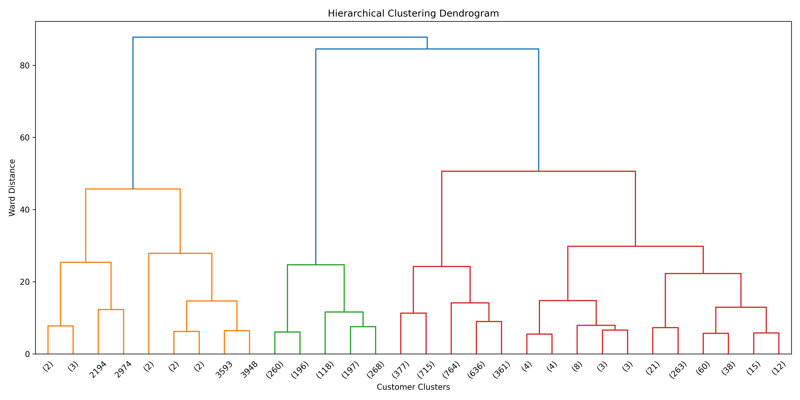

# 🛒 Real-Time E-Commerce Big Data & Lakehouse Platform

[](https://www.python.org/)
[](https://spark.apache.org/)
[](https://kafka.apache.org/)
[](https://airflow.apache.org/)
[](https://streamlit.io/)
[](https://www.docker.com/)
[](tests/)

An enterprise-grade, dual-engine (Batch + Real-Time) Lakehouse platform designed to ingest, process, model, and visualize high-velocity retail transactions and live customer clickstream events at enterprise scale.

---

## 🏛️ System Architecture



---

## 📦 Key Highlights & Engineering Metrics

- **Medallion Lakehouse ETL**: Ingests **541,909 raw transactions**, enforcing data quality invariants to isolate 144K+ invalid/cancelled rows, persisting **397,884 clean records** (£8.91M net sales) into partitioned Silver and Gold Parquet stores.
- **Fault-Tolerant Real-Time Stream**: Ingests live multi-action events (`view`, `add_to_cart`, `purchase`, `cancel`) via **Spark Structured Streaming** with 10-minute event-time watermarking and write-ahead metadata checkpointing.
- **Dimensional Star Schema & Graph Modeling**: Built `dim_customer` (RFM features), `dim_product`, and an **8,003-node bipartite network graph** (4,338 customer nodes, 3,665 product nodes, 266,792 edges) via NetworkX to detect purchasing hubs and co-purchase affinities.
- **Customer Segmentation & Predictive AI**:
  - **RFM Clustering**: Partitioned customers into 3 distinct cohorts (VIP Whales, Active Shoppers, At-Risk) with a **Silhouette score of 0.7138**.
  - **90-Day Churn Prediction**: Logistic Regression achieving **66.67% accuracy** and **67.26% precision**.
  - **CLV Spending Prediction**: PySpark Linear Regression explaining **59.23% variance ($R^2$)** in future 90-day spend.
- **Workflow Orchestration**: Automated end-to-end DAG defined in **Apache Airflow** (`dags/ecommerce_etl_dag.py`) with retries, dependency graphs, and health checks.
- **Single-Command Orchestration**: Unified CLI runner (`run_pipeline.py`) and Docker Compose environment (`docker-compose.yml`) for zero-friction setup.
- **Executive Presentation Deck**: Includes an editable 13-slide widescreen deck: [`Ecommerce_BigData_Analytics_Presentation.pptx`](Ecommerce_BigData_Analytics_Presentation.pptx).

---

## 📊 Analytical Visualizations & Graph Intelligence

| Bipartite Customer-Product Network Graph | Hierarchical Ward Linkage Dendrogram |
|:---:|:---:|
|  |  |
| **8,003 Nodes & 266,792 Edges**: Blue nodes represent customers; orange nodes represent products; edge weights reflect purchased volume to identify purchase hubs and affinity bundles. | **Silhouette Score: 0.7138 (k=3)**: Validates clean separation into 3 distinct cohorts: VIP Whales (£111K+ avg spend), Active Shoppers, and At-Risk Dormant buyers. |

---

## 🗄️ Medallion Data Modeling (Star Schema)

The batch ETL pipeline transforms raw data through three structured layers:

### 1. Silver Conformed Layer (`data/processed/silver_transactions/`)
- **Format**: Apache Parquet (Snappy-compressed), partitioned by `Year` and `Month`.
- **Invariants**: Excludes cancelled orders (`InvoiceNo` starting with `'C'`), bad debts (`'A'`), `Quantity <= 0`, `UnitPrice <= 0`, and null `CustomerID`s.

### 2. Gold Dimensional Models
- **`dim_customer`** (`data/processed/gold_dim_customer/`):
  - `CustomerID`, `LastPurchaseDate`, `Recency` (days since snapshot), `Frequency` (distinct invoices), `Monetary` (total revenue), `TotalQuantityPurchased`, `PrimaryCountry`.
- **`dim_product`** (`data/processed/gold_dim_product/`):
  - `StockCode`, `Description`, `TotalUnitsSold`, `TotalProductRevenue`, `TotalOrdersAppearedIn`.
- **`fact_sales_monthly`**:
  - `Year`, `Month`, `Country`, `MonthlyRevenue`, `MonthlyUnitsSold`, `TotalInvoices`.

---

## 🛠️ Tech Stack

| Category | Tools & Libraries |
|---|---|
| **Distributed Compute** | Apache Spark 3.5+, PySpark (SQL, Streaming, MLlib) |
| **Message Streaming** | Apache Kafka, Kafka-Python, Confluent Docker Images |
| **Workflow Orchestration** | Apache Airflow (`dags/ecommerce_etl_dag.py`) |
| **Storage & Data Lake** | Apache Parquet (Snappy-compressed), CSV, Metadata Checkpoints |
| **Machine Learning & Graph** | Scikit-Learn, SciPy, NetworkX, NumPy, Pandas |
| **Dashboard & UI** | Streamlit, Matplotlib |
| **DevOps & Testing** | Docker, Docker Compose, Unittest, Pytest, PyYAML |

---

## 📂 Project Directory Structure

```
Ecommerce-BigData-Analytics/
├── config/
│   ├── config.yaml                 # Centralized environment, paths, Kafka & Spark settings
│   └── settings.py                 # Dynamic configuration loader and path resolver
├── dags/
│   └── ecommerce_etl_dag.py        # Apache Airflow workflow DAG definition
├── dashboard/
│   └── app.py                      # Multi-tab Streamlit Executive Dashboard
├── data/
│   ├── raw/                        # Ingestion raw datasets (.gitkeep)
│   ├── processed/                  # Silver & Gold conformed Parquet tables (.gitkeep)
│   └── streaming/                  # Parquet streaming sink & write-ahead checkpoint logs (.gitkeep)
├── docker-compose.yml              # Local Kafka, Zookeeper & Kafka UI orchestration
├── graph/
│   └── customer_product_graph.py   # Bipartite network graph generation & centrality
├── kafka/
│   └── producer.py                 # Real-time synthetic clickstream event publisher
├── ml/
│   ├── feature_engineering.py      # RFM vector calculation & StandardScaler
│   ├── hierarchical_clustering.py  # Ward linkage agglomerative clustering & dendrogram
│   ├── kmeans_clustering.py        # K-Means clustering with WCSS & Silhouette evaluation
│   ├── linear_regression.py        # PySpark CLV spending prediction
│   ├── logistic_regression.py      # PySpark 90-day churn classification
│   └── model_comparison.py         # Evaluation benchmark exporter
├── results/                        # PNG charts, linkage matrices, and model metrics CSV
├── spark/
│   ├── eda.py                      # PySpark exploratory analysis
│   └── etl_pipeline.py             # Modular Medallion PySpark ETL pipeline
├── streaming/
│   ├── spark_kafka_consumer.py     # Spark Structured Streaming Kafka consumer with watermarking
│   └── verify_stream.py            # Streaming health auditor & partition inspector
├── tests/
│   └── test_etl_pipeline.py        # Automated test suite (cleaning, schemas, RFM invariants)
├── utils/
│   └── logger.py                   # Centralized structured logging formatter
├── run_pipeline.py                 # Unified master CLI orchestrator
├── Ecommerce_BigData_Analytics_Presentation.pptx  # 13-slide presentation deck
├── requirements.txt                # Pinned Python dependencies
└── README.md                       # Documentation & Architecture Overview
```

---

## 🚀 Quickstart Guide

### 1. Environment Setup
```bash
# Clone the repository
git clone https://github.com/udaykumar-cs/Ecommerce-BigData-Analytics.git
cd Ecommerce-BigData-Analytics

# Create and activate virtual environment
python -m venv venv
source venv/bin/activate  # On Windows: venv\Scripts\activate

# Install dependencies
pip install -r requirements.txt
```

### 2. Launch Local Kafka Infrastructure
```bash
# Spin up Kafka, Zookeeper, and Kafka UI with one command
docker compose up -d

# Open Kafka UI in your browser to inspect topics and partitions:
# http://localhost:8085
```

### 3. Run Pipeline via Master CLI Runner
The repository includes `run_pipeline.py` to trigger individual or end-to-end components:

```bash
# Run automated data quality and invariant tests (5/5 passing)
python run_pipeline.py --step test

# Execute PySpark Medallion ETL pipeline (Bronze -> Silver -> Gold)
python run_pipeline.py --step etl

# Ingest simulated clickstream events into Kafka
python run_pipeline.py --step producer --events 50

# Start Spark Structured Streaming consumer
python run_pipeline.py --step consumer

# Audit streaming Parquet partition health
python run_pipeline.py --step verify-stream

# Generate customer-product bipartite graph
python run_pipeline.py --step graph

# Launch executive Streamlit dashboard
python run_pipeline.py --step dashboard
```

---

## 🧠 Architectural Decisions & Engineering Trade-Offs

| Decision | Alternative Considered | Why This Choice Was Made |
|---|---|---|
| **Apache Spark over Pandas** | Single-node Pandas | Pandas requires entire datasets to fit in RAM and lacks distributed execution. PySpark enables Catalyst query optimization, distributed joins, and scales horizontally to tens of millions of records. |
| **Apache Parquet over CSV** | Flat CSV / JSON | Parquet uses columnar storage with dictionary encoding and Snappy compression, enabling **predicate pushdown** (skipping unneeded column reads) and reducing disk footprint by >70%. |
| **Spark Structured Streaming over DStreams** | Legacy RDD DStreams | Structured Streaming is built directly on the Spark SQL catalyst engine, providing unified APIs for batch and streaming, native event-time watermarking, and write-ahead metadata checkpointing for fault-tolerant state recovery. |
| **10-Minute Watermarking** | Drop late events | Real-world clickstream networks experience network latency and client retransmits. A 10-minute watermark bounds state memory while allowing delayed messages to merge seamlessly. |
| **Medallion Lakehouse Architecture** | Single monolithic table | Decouples raw immutable ingest (Bronze) from conformed business entities (Silver) and aggregated serving layers (Gold), preventing pipeline re-runs from corrupting historical data. |

---

## 🧪 Data Invariants & Quality Rules

1. **Transaction Validity**: Records with invoice numbers starting with `'C'` (cancellations) or `'A'` (bad debts) are systematically filtered out of revenue metrics.
2. **Numeric Boundaries**: `Quantity > 0` and `UnitPrice > 0` constraints prevent distorted margins.
3. **Identity Resolution**: Missing `CustomerID` records are isolated from customer-level RFM modeling while retained for SKU catalog aggregation.
4. **Streaming Resilience**: Spark Structured Streaming utilizes metadata checkpointing and 10-minute watermarking to handle out-of-order records and prevent duplicate writes.

---

## 🔮 Future Roadmap
- **Delta Lake Integration**: Migrate Parquet storage to Delta Lake for ACID transactions, schema enforcement, and time-travel querying.
- **Cloud Scale**: Deploy Kafka onto **Amazon MSK** and PySpark jobs onto **Databricks / AWS EMR**.
- **Generative AI Copilot**: Integrate an LLM agent within Streamlit to query retail metrics in natural language.
